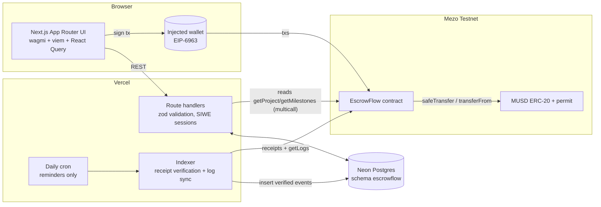
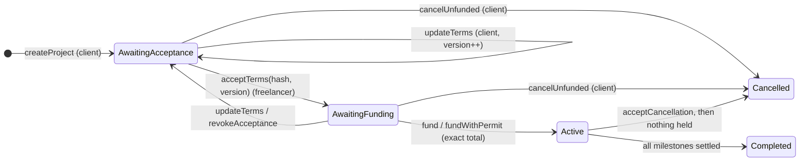
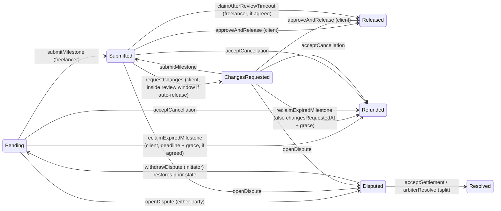

# MUSD EscrowFlow

**Work with confidence. Pay with trust.** Milestone-based freelance escrow, paid in MUSD on Mezo.

- **Live app:** https://musd-escrowflow.vercel.app
- **EscrowFlow contract (Mezo Testnet):** [`0xC52C7d72aDeb81998A3eAB2d3a25634C43822fdE`](https://explorer.test.mezo.org/address/0xC52C7d72aDeb81998A3eAB2d3a25634C43822fdE)
- **Deploy transaction:** [`0x9bdaf8c8…c3dc6b`](https://explorer.test.mezo.org/tx/0x9bdaf8c89ff30c3b32579d707cbe8126f9f98724ddfd678653a0384590c3dc6b) (block 16,381,473)
- **Network:** Mezo Testnet, chain id 31611. Test tokens have no monetary value.

---

## What it is

Freelancers worry that clients won't pay after the work is delivered. Clients worry about paying for work that never arrives. Both sides lack a neutral, verifiable record of what was agreed, funded, delivered and paid.

EscrowFlow fixes this with a smart contract:

1. The client writes the agreement — milestones, amounts, deadlines, review periods, cancellation and dispute rules.
2. The escrow is created on-chain with those parameters and a **keccak256 hash of the agreement document**.
3. The freelancer accepts that **exact version** (hash + version must match; any edit before funding resets acceptance).
4. The client deposits the full budget in MUSD. The contract **measures what it received** and rejects a short deposit.
5. Each milestone is submitted (the submission's hash and timestamp go on-chain), then approved — which releases that milestone's MUSD straight to the freelancer — or sent back for changes, or disputed.
6. Funding, releases, refunds and settlements are all on-chain facts. The app never shows money as moved until the transaction receipt and the MUSD `Transfer` log are verified server-side.

There is no admin key, no upgrade path, no pause switch and no platform fee.

## Features that work today

**Escrow lifecycle (on-chain, verified)**
- Create escrow from an agreement draft (direct hire) or after selecting an applicant (open listing)
- Freelancer accepts the exact terms version; the browser recomputes the terms hash and compares every amount, deadline, review period, arbiter and rule with the contract before enabling "Accept"
- Fund with **one transaction via EIP-2612 permit** on real MUSD, or approve + fund
- Submit work (description, links, up to 5 PNG/JPEG/WebP/PDF attachments ≤ 2 MB, access-controlled) → `submitMilestone(hash)`
- Approve and release, request changes (reason hash on-chain), open dispute (reason hash on-chain)
- **Auto-release after an unanswered review period** (if agreed) — the freelancer claims; nothing is released by a frontend timer
- **Deadline reclaim** for undelivered milestones after deadline + grace (if agreed)
- Disputes: mutual split (propose / counter-propose / accept exact amount), optional arbiter ruling, withdrawal by initiator
- Mutual cancellation of a funded project (refunds only unpaid, undisputed milestones; paid work is never reversed)
- Unfunded cancellation, terms revisions before funding (append-only revision history), acceptance revocation

**Product**
- 15 spec pages: landing, dashboard, marketplace, freelancer profile, create project, project details, milestone details, fund escrow, submit work, review submission, payments & transactions, dispute centre, notifications, profile & settings, help & about
- Client and freelancer dashboards computed from contract state: locked vs released vs refunded, "allocated (not earned)" kept separate from "received", pending actions, upcoming/overdue deadlines, recent verified payments
- Marketplace with search + filters (keyword, category, budget range, deadline, status, sort) and a freelancer directory
- Profiles with **verified on-chain work history derived only from the contract** (received MUSD, milestones paid, completed projects) next to clearly-labelled self-reported details and user reviews (one per participant per completed project)
- Project timeline mixing **"On-chain fact"** (decoded, verified EscrowFlow events with tx links) and **"Application record"** entries (comments, drafts, uploads)
- Notifications created from verified chain events (never before confirmation), application events, and a daily reminder cron for deadlines / review periods
- SIWE (EIP-4361) sign-in with single-use server nonces; HttpOnly JWT session

**Extras**
- Signature React Three Fiber hero: an escrow vault holding MUSD, four milestone rings that unlock in sequence and a token stream flowing to the freelancer (paused off-screen / hidden tab, DPR ≤ 1.75, SVG poster for reduced motion and small screens)
- Milestone templates (website build, brand identity, article series) and "split evenly"
- Printable agreement (serif document view with the on-chain terms hash) — print or save as PDF
- Deadline calendar export (`.ics`, RFC 5545) per project
- QR / link invite for the freelancer
- ⌘K / Ctrl K command palette, "Add Mezo Testnet" and "Add MUSD" wallet helpers, wrong-network guard, live block height
- Payments CSV export, public facts-only escrow page (`/escrow/<id>`), legal pages, sitemap/robots, OG image, Vercel Analytics + Speed Insights

## Architecture



- **The chain is the source of truth for money.** Dashboards, ledgers and statuses are read live from `getProject` / `getMilestones` (Multicall3). The database stores application records (profiles, drafts, submissions, comments, attachments) and a re-derivable cache of verified events. It never overrides contract state.
- **Verification path:** after every write the client posts the tx hash to `/api/tx/verify`. The server fetches the receipt, requires `status = success`, `to = EscrowFlow`, decodes EscrowFlow events and requires an **exact MUSD `Transfer` log** (from the official MUSD contract, matching from/to/value) for every money-moving event, then stores events with a UNIQUE `(tx_hash, log_index)`. A background sync (`getLogs` in 9k-block chunks, run via `after()` while the app is used, plus the daily cron) catches anything posted elsewhere.

## Escrow state machine



Per milestone (only while the project is `Active`):



`Released`, `Refunded` and `Resolved` are terminal — a milestone pays out **at most once**.

**Rules and invariants enforced by the contract**
- Only the client funds, only after the freelancer accepted the current version, only if every deadline is still in the future; the exact total must arrive (`FundingShortfall` otherwise, e.g. fee-on-transfer tokens).
- The client can never claw back released funds; the freelancer can never withdraw unapproved funds (every payout path is gated: approval, agreed review timeout, settlement accepted by the counterparty, arbiter ruling).
- Once an agreed auto-release has vested (review period elapsed), the client can no longer request changes or dispute that submission — they can still approve.
- A dispute freezes the milestone: no approval, claim, reclaim or cancellation refund until resolved. A disputed milestone survives a mutual cancellation and must then be settled (it cannot be withdrawn).
- A new submission automatically withdraws a pending cancellation proposal so it cannot sweep fresh work.
- Per project: `fundedAmount == releasedAmount + refundedAmount + held`; globally `totalHeld` equals the sum of held funds and `MUSD.balanceOf(escrow) >= totalHeld` (stray donations never enter accounting).
- `nonReentrant` on every function that moves tokens, checks-effects-interactions, `SafeERC20`, custom errors, rich indexed events, no arbitrary external calls.
- Limits: 1–20 milestones, review period 60 s – 90 days (the 60 s floor exists so the timeout path can be demonstrated on testnet; the UI defaults to days), grace ≤ 90 days, deadlines ≤ 5 years out.

## Mezo / MUSD integration

| Item | Value |
|---|---|
| Network | Mezo Testnet · chain id 31611 · RPC `https://rpc.test.mezo.org` · explorer `https://explorer.test.mezo.org` |
| MUSD | [`0x118917a40FAF1CD7a13dB0Ef56C86De7973Ac503`](https://explorer.test.mezo.org/token/0x118917a40FAF1CD7a13dB0Ef56C86De7973Ac503) — 18 decimals, EIP-2612 permit (domain "Mezo USD", version "1", verified live) |
| EscrowFlow | [`0xC52C7d72aDeb81998A3eAB2d3a25634C43822fdE`](https://explorer.test.mezo.org/address/0xC52C7d72aDeb81998A3eAB2d3a25634C43822fdE) — deployed by `0x10ac9924a78051BdD770978740C5084205cdB628` in [`0x9bdaf8c8…`](https://explorer.test.mezo.org/tx/0x9bdaf8c89ff30c3b32579d707cbe8126f9f98724ddfd678653a0384590c3dc6b) |
| Multicall3 | `0xcA11bde05977b3631167028862bE2a173976CA11` |
| Reference (docs only) | BorrowerOperations `0xCdF7028ceAB81fA0C6971208e83fa7872994beE5`, TroveManager `0xE47c80e8c23f6B4A1aE41c34837a0599D5D16bb0`, PriceFeed `0x86bCF0841622a5dAC14A313a15f96A95421b9366`, StabilityPool `0x1CCA7E410eE41739792eA0A24e00349Dd247680e` |

Addresses come from the official `mezo-org/musd` matsnet deployment files and the Mezo docs. The ABI used by the app is generated from the compiled contract (`src/config/abi/escrowFlow.ts`); deployment metadata is in `src/config/deployment.json`.

**Gas:** Mezo testnet enforces the EIP-7623 calldata floor and the public RPC occasionally under-estimates. Every write (UI and scripts) sends an explicit gas limit: `max(estimate × 1.3, per-function floor)`, treating estimates below 30k as invalid (`src/lib/gas.ts`).

**Source verification:** Blockscout verification was submitted (standard JSON input, solc 0.8.28, optimizer 200, evm london) and accepted for processing but had not shown as verified at the time of writing. The full source, compiler settings and ABI are in `contracts/`.

## Tech stack

Next.js 16 (App Router, TypeScript strict) · Tailwind CSS 4 · Radix primitives · wagmi 2 + viem 2 + TanStack Query · React Three Fiber + three.js · Neon Postgres (`@neondatabase/serverless`) · SIWE via `viem/siwe` + `jose` · zod · Solidity 0.8.28 + OpenZeppelin 5 + Hardhat 2 · Vitest · Vercel (cron, analytics). Type: IBM Plex Sans / Serif / Mono with tabular numerals.

## Local setup

```bash
npm install
npm --prefix contracts install
vercel link --yes --project musd-escrowflow && vercel env pull .env.local --yes   # or copy .env.example
npm run db:migrate          # idempotent, schema "escrowflow" only
npm run dev                 # http://localhost:3000
```

Contracts:

```bash
npm run contracts:test      # Hardhat tests
npm run contracts:compile && npm run contracts:abi
npm run contracts:deploy    # reads PRIVATE_KEY at runtime from DEPLOYER_ENV_FILE (outside the repo)
```

### Environment variables (`.env.example`)

| Name | Where | Purpose |
|---|---|---|
| `DATABASE_URL` | server | Neon Postgres (provisioned by the Vercel Neon integration) |
| `SESSION_SECRET` | server | HS256 key for the session JWT (48 random bytes) |
| `CRON_SECRET` | server | Bearer token required by `/api/cron/reminders` |
| `MEZO_RPC_URL` | optional | RPC override |
| `DEPLOYER_ENV_FILE`, `TEST_WALLETS_FILE`, `BASE_URL`, `E2E_DIVISOR` | scripts only | deploy / e2e configuration; keys are read from files outside the repo and never printed |

## Database schema (`escrowflow`)

| Table | Holds |
|---|---|
| `users`, `siwe_nonces` | wallet identities; single-use, expiring SIWE nonces |
| `profiles` | display name, role, bio, skills, portfolio/social links, avatar (bytea ≤ 512 KB), notification prefs |
| `projects` | agreement draft / listing, canonical terms JSON + hash, link to `chain_project_id` (UNIQUE) |
| `terms_revisions` | append-only history of every terms version and hash |
| `applications` | Flow B applications (UNIQUE per freelancer per project) |
| `submissions`, `attachments` | submission records (hash UNIQUE, linked tx) and private files (bytea ≤ 2 MB, MIME allow-list + magic-byte sniffing) |
| `comments` | review comments, change-request and dispute reasons (with on-chain hash), evidence |
| `chain_events`, `sync_state` | cache of verified EscrowFlow events, UNIQUE `(tx_hash, log_index)` |
| `notifications`, `audit_events`, `reviews` | deduplicated notifications, application-record audit trail, one review per participant per completed project |

## Testing

| Suite | Command | Latest result |
|---|---|---|
| Contract tests (Hardhat) | `npm run contracts:test` | **152 passing** — creation/validation, agreement & versioning, funding incl. permit, shortfall (fee-on-transfer), release, duplicate release, unauthorised callers, review timeout, cancellation & refund rules, disputes, failed token transfers (false-returning and reverting tokens), reentrancy via malicious token and contract parties, accounting invariants after every step, 3 seeded fuzz runs × 200 random actions |
| Contract coverage | `npm --prefix contracts run coverage` | EscrowFlow.sol: **100 % statements, 97.8 % branches, 100 % functions, 100 % lines** |
| Unit tests (Vitest) | `npm test` | **57 passing** — money math (bigint, no floats), canonical JSON + hashing, terms ↔ chain comparison, state machine mirror & action gating, ledger reconciliation, draft validation (exact milestone sums), upload sniffing, gas policy, ICS export |
| Build / types / lint | `npm run build`, `npm run typecheck`, `npm run lint` | clean |
| Live e2e (real testnet) | `BASE_URL=… npm run e2e` | local rehearsal **71/71 checks, 19 txs**; production — see below |

### Live end-to-end results (production, real MUSD)

Run against https://musd-escrowflow.vercel.app with the three test wallets (client, freelancer, stranger). Spec §26 scenario with 200 MUSD (40/60/60/40), then a dispute split on M2, mutual cancellation of M3+M4 and a second project for the unresponsive-client and undelivered-milestone paths. Logs: `docs/e2e-production-part{1,2,3}.log`.

The production run took three invocations: the first stopped at a test-harness assertion that compared wallet-wide dashboard totals (the client wallet also had the earlier rehearsal escrows) — the assertion now checks the project's own ledger and the run resumed from the same funded escrow (`E2E_RESUME_PROJECT`); the second stopped because the testnet block timestamp lagged the local clock before the reclaim — the script now waits on chain time, and the last step finished with `E2E_FINISH_B`. No contract or app change was needed. 81 checks passed in total.

| Step | Transaction |
|---|---|
| A: createProject (escrow #3) | [0x3304cbe8…](https://explorer.test.mezo.org/tx/0x3304cbe8af2bf14bd3495f9d717aae7a0519400b7cdabb72c8bca62723c496d2) |
| A: acceptTerms (freelancer) | [0xc1a3d722…](https://explorer.test.mezo.org/tx/0xc1a3d722f3edbe77300f438bbc5fa88aeed9ed0f9761620f9ca520c49fe82479) |
| A: fundWithPermit 200 MUSD (one tx) | [0xeb8609ec…](https://explorer.test.mezo.org/tx/0xeb8609ecc666fd4c1b3ffd4783365b669690df0d18c08cfef73d707671246bc9) |
| A: submit M1 | [0x9e62be43…](https://explorer.test.mezo.org/tx/0x9e62be432b3de84364417ff491158d99772f35a78fb842769c95be49a8d2fb8b) |
| Stranger approveAndRelease — **reverted on-chain** | [0x8ff96a77…](https://explorer.test.mezo.org/tx/0x8ff96a776f6f0881220434e155d1044ee1293e021afe5ff2a01d0bf135f80dc6) |
| A: approve + release M1 → **40 MUSD to freelancer** | [0x7a0b6250…](https://explorer.test.mezo.org/tx/0x7a0b62502bd5d8950041c9e964def07c52cb2fedd59ca5241f73848982906c42) |
| Dashboard: project shows 40 released / 160 held | (API assertion) |
| A: submit M2 | [0x108ddbaf…](https://explorer.test.mezo.org/tx/0x108ddbaf5921bf9f296a8c89e1ef546202d7e99166a6147c58fa1dbc8d9ed0f5) |
| A: openDispute M2 | [0x1cc05d61…](https://explorer.test.mezo.org/tx/0x1cc05d6165cfe4827878b6c500ba7ad278c7c829f22ba5c92c6f028b5e92fed8) |
| A: proposeSettlement 30/30 | [0x3c40eb8c…](https://explorer.test.mezo.org/tx/0x3c40eb8ce57ee469328ec170a2b2381c681583154492eadba8098bef96be8fcc) |
| A: acceptSettlement → 30 to freelancer + 30 to client | [0x48bab5c1…](https://explorer.test.mezo.org/tx/0x48bab5c17b88d6872856cdfa22cd4a1d71bc856db06579508eb74b7c25e4c254) |
| A: proposeCancellation | [0x1cc8fa58…](https://explorer.test.mezo.org/tx/0x1cc8fa58641277b16f47f5bbbbf659eb361cdf8c96846c52b647a3637e9fc351) |
| A: acceptCancellation → 100 MUSD refunded (M3+M4) | [0x886e9ef4…](https://explorer.test.mezo.org/tx/0x886e9ef452c47d1c75511b5737d344a67c201ba396fba78f0bbddd6991d001dd) |
| B: createProject (escrow #4) | [0x137ddbdf…](https://explorer.test.mezo.org/tx/0x137ddbdf07a1fae14483e4e36e83af54d67aee95c0dcea880e23e1f1ac01e842) |
| B: acceptTerms / approve / fund | [0xcddf23d5…](https://explorer.test.mezo.org/tx/0xcddf23d5456c8f255d756ee8a9d896519d6cb5eb9752c7f268743ea3b7ee018f) · [0xd48bb9fb…](https://explorer.test.mezo.org/tx/0xd48bb9fb709c281f3242cd2ba4bdfb2fa840356de324c21c01375d8a2a7f38f6) · [0xdaee6435…](https://explorer.test.mezo.org/tx/0xdaee6435efcb67ce1baa367dac0f892abe9fb1c5fda93ce3012697a8f2bff4f8) |
| B: submit M1, then claimAfterReviewTimeout (client silent) | [0x28200a18…](https://explorer.test.mezo.org/tx/0x28200a1899c08c84d79ff33011932fa4f24e030780e9f4e265f2ea39aecb0a29) · [0xf1e10574…](https://explorer.test.mezo.org/tx/0xf1e1057475eefa46a8d48b9bd63f1efdbb5cc6a8772ec2389e91fb409429cf71) |
| B: reclaimExpiredMilestone M2 (never delivered) | [0x6f15be34…](https://explorer.test.mezo.org/tx/0x6f15be34666fcc609b07e90f227104f330cfbdd2c611be9c90f0ea12789834de) |

Negative cases asserted along the way: replayed SIWE message (401), dashboard without session (401), milestones not summing to the budget (400), stranger accept/release/cancel (`NotFreelancer` / `NotClient` / `NotParty`), funding before acceptance and twice, duplicate release, claiming a paid milestone, releasing or claiming a disputed milestone, accepting one's own settlement, claiming inside the review window (`ReviewWindowOpen`), requesting changes after a vested auto-release (`ReviewWindowElapsed`), a stranger reading private terms or attachments (403). Final ledger of escrow #3: funded 200 = released 70 + refunded 130 + held 0. Contract `totalHeld` returned to 0.

## Security model

- **Non-custodial.** The app never asks for keys or seed phrases and never signs for the user; every money movement is a wallet transaction with an explicit confirmation dialog.
- **Contract enforces everything that matters** (see rules above). The frontend is never the only protection.
- **Server-side verification** of receipts and exact MUSD transfer logs before anything is shown as funded or paid; UNIQUE tx/log constraints prevent double counting; pending ≠ confirmed (receipt delays show as "verification delayed").
- **SIWE sessions**: domain, URI, chain id 31611, issued-at freshness and expiry checked; nonces are single-use and expire after 10 minutes; session cookie is HttpOnly, Secure, SameSite=Lax; mutating requests reject cross-origin `Origin` headers.
- **Authorization on every route**: project terms, submissions, comments, evidence and attachments are visible only to the client, freelancer and arbiter; attachments are served from an authorised route with `nosniff`, a restrictive CSP and `attachment` disposition for PDFs.
- **Uploads**: ≤ 2 MB each, ≤ 4 MB per request, MIME allow-list enforced by magic-byte sniffing (a renamed SVG/EXE is rejected).
- **Secrets**: deployer and test-wallet keys are read at runtime from files outside the repo and never logged; `.env*`, contract caches and key material are git- and Vercel-ignored.

## Known limitations (honest list)

- Testnet only; the contract has extensive tests but **no third-party audit**.
- Without an arbiter, a dispute where one party stops responding stays frozen; without deadline reclaim / auto-release, the corresponding stalemates also need cooperation. The UI explains which rules apply to each project.
- Terms cannot be amended after funding (by design). An amendment means mutual cancellation and a new escrow.
- Reminders run once per day (Vercel Hobby cron). Live status refreshes every ~20 s while the app is open; review timers are enforced by block timestamps, not by our servers.
- Email and browser push notifications are not implemented (in-app only).
- The e2e signs the test wallets' SIWE messages in a script; the browser wallet flow was exercised manually only through rendering checks, not an automated wallet extension.
- Blockscout source verification was submitted but not confirmed as verified at the time of writing.

## Two-minute demo for judges

1. Get testnet BTC for gas at https://faucet.test.mezo.org/ and some test MUSD (open a trove on https://testnet.mezo.org). Use two browser profiles (client and freelancer wallets).
2. Open https://musd-escrowflow.vercel.app → **Connect wallet** → **Sign in** (a gas-free signature). Use "Add Mezo Testnet" if prompted.
3. Client: **New project** → pick the "Website build" template → enter the freelancer's address → set one milestone's review period to "10 minutes (testnet demo)" → **Save agreement draft** → **Create escrow on-chain**.
4. Freelancer: open the invite link/QR → the Terms tab shows the agreement; the green "Terms verified" notice means the browser re-hashed it and matched every on-chain parameter → **Accept terms**.
5. Client: **Fund escrow** → **Sign permit and fund** (one transaction). The escrow bar turns indigo (held).
6. Freelancer: **Submit work** on M1 with a link and a PDF. Client: **Review** → **Approve and release** → the M1 segment turns cyan; the freelancer's dashboard shows the payment with its explorer link.
7. Try a dispute on M2 (propose a split, accept it from the other wallet), then open **Payments** and **Activity** to see on-chain facts vs application records.

## Pitch and roadmap

Freelance platforms take 10–20 % and still hold your money in their own accounts. EscrowFlow keeps the useful part — a neutral holder of funds with clear milestone rules — and makes it a public, fee-free contract on a Bitcoin-backed dollar. Both sides can prove what was agreed, when work was delivered and when it was paid, without trusting us.

Roadmap: third-party audit · arbiter marketplace with bonded, rated arbiters and fee schedules · amendments via a second signed agreement · partial milestone releases · multi-token support (MUSD first, then sMUSD yield while funds sit in escrow) · email / push notifications · team accounts for agencies · mainnet launch on Mezo.

---

Original product specification: [`project.md`](./project.md).
