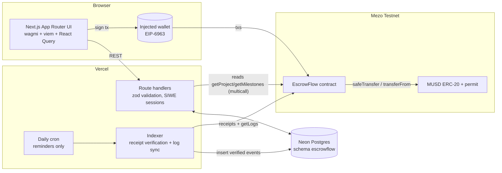
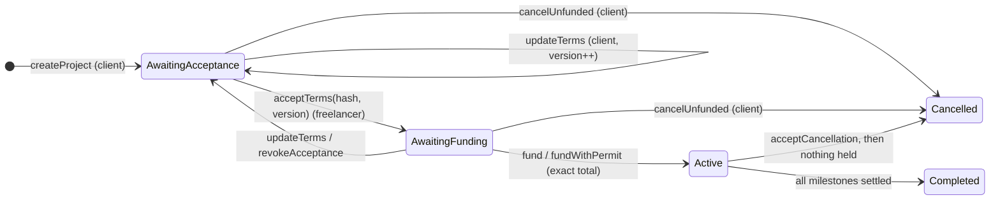
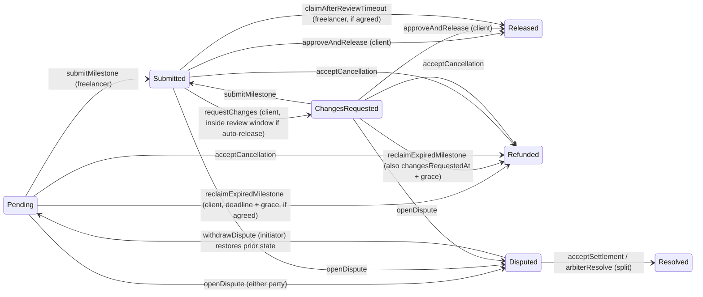

# MUSD EscrowFlow

**Work with confidence. Pay with trust.** Milestone-based freelance escrow, paid in MUSD on Mezo.

- **Live app:** https://musd-escrowflow.vercel.app
- **EscrowFlow v2 (Mezo Testnet, source-verified):** [`0x8AfaAcA2CC9C6365E5ac1DE46C090C49009982f8`](https://explorer.test.mezo.org/address/0x8AfaAcA2CC9C6365E5ac1DE46C090C49009982f8#code) · deploy tx [`0xf1ca6184…`](https://explorer.test.mezo.org/tx/0xf1ca61849b3f348e8eaedeb4a9535004d443f020bafe94701e02d3ed29e42bd9) (block 16,776,080)
- **EscrowFlow v1 (legacy, source-verified, all escrows settled):** [`0xC52C7d72aDeb81998A3eAB2d3a25634C43822fdE`](https://explorer.test.mezo.org/address/0xC52C7d72aDeb81998A3eAB2d3a25634C43822fdE#code)
- **Network:** Mezo Testnet, chain id 31611. Test tokens have no monetary value.

### What changed in v2 (wave 2)

- **Mezo-native money flows.** Escrows can keep their held budget in Mezo's **MUSDSavingsRate (sMUSD)** vault, 1:1, and split the yield between client and freelancer by an agreed share. Clients short on MUSD can **borrow it against BTC through Mezo's BorrowerOperations** (draw on a trove or open one) straight from the funding page.
- **Security review and fixes.** An internal review of the contract found one must-fix (a client could sweep a disputed, submitted milestone through withdraw-dispute + accept-cancellation) and four should-fixes; all are fixed in v2 with regression tests, and the must-fix is re-proven live in the e2e run.
- **Both contracts verified on the Mezo explorer**, and a public **Network activity** page that lists every escrow with team test wallets labelled, so outside usage is visible at a glance.
- **Redesign:** three colours (navy slate, one brass accent, signal red for disputes only), no gradients, serif display type taken from the agreement document, and the escrow statement as the hero.

---

## What it is

Freelancers worry that clients won't pay after the work is delivered. Clients worry about paying for work that never arrives. Both sides lack a neutral, verifiable record of what was agreed, funded, delivered and paid.

EscrowFlow fixes this with a smart contract:

1. The client writes the agreement — milestones, amounts, deadlines, review periods, cancellation and dispute rules.
2. The escrow is created on-chain with those parameters and a **keccak256 hash of the agreement document**.
3. The freelancer accepts that **exact version** (hash + version must match; any edit before funding resets acceptance).
4. The client deposits the full budget in MUSD. The contract **measures what it received** and rejects a short deposit.
5. Each milestone is submitted (the submission's hash and timestamp go on-chain), then approved — which releases that milestone's MUSD straight to the freelancer — or sent back for changes, or disputed.
6. Funding, releases, refunds and settlements are all on-chain facts. The app never shows money as moved until the transaction receipt and the MUSD `Transfer` log are verified server-side.

There is no admin key, no upgrade path, no pause switch and no platform fee.

## Features that work today

**Mezo integration (calls Mezo's own contracts)**
- **sMUSD savings (opt-in, part of the signed terms):** funding deposits the budget into MUSDSavingsRate in the same transaction; every release, refund, settlement and cancellation withdraws exactly its amount 1:1; yield is attributed per project (MasterChef-style accumulator, a project never shares yield earned before it was funded) and `distributeYield` pays it out by the agreed split
- **Fund by borrowing against BTC:** the funding page reads the client's trove (TroveManager), the BTC price (PriceFeed) and Mezo's fee / MCR / capacity rules (BorrowerOperations), previews the fee and the collateral ratio after the loan, computes sorted-list hints with `SortedTroves.findInsertPosition`, and sends `withdrawMUSD` or `openTrove` from the client's wallet
- MUSD with EIP-2612 permit for one-transaction funding; every money movement checked against the exact MUSD `Transfer` log

**Escrow lifecycle (on-chain, verified)**
- Create escrow from an agreement draft (direct hire) or after selecting an applicant (open listing)
- Freelancer accepts the exact terms version; the browser recomputes the terms hash and compares every amount, deadline, review period, arbiter and rule with the contract before enabling "Accept"
- Fund with **one transaction via EIP-2612 permit** on real MUSD, or approve + fund
- Submit work (description, links, up to 5 PNG/JPEG/WebP/PDF attachments ≤ 2 MB, access-controlled) → `submitMilestone(hash)`
- Approve and release, request changes (reason hash on-chain), open dispute (reason hash on-chain)
- **Auto-release after an unanswered review period** (if agreed) — the freelancer claims; nothing is released by a frontend timer
- **Deadline reclaim** for undelivered milestones after deadline + grace (if agreed)
- Disputes: mutual split (propose / counter-propose / accept exact amount), optional arbiter ruling, withdrawal by initiator. **v2:** time spent disputed pauses the milestone's clocks (review window, deadline, grace) instead of resetting them, and a freelancer cannot dispute work they never submitted
- Mutual cancellation of a funded project (refunds only unpaid, undisputed milestones; paid work is never reversed). **v2:** the accepting party passes the exact refund they reviewed (`RefundMismatch` otherwise), and opening or withdrawing a dispute withdraws any pending cancellation proposal
- Unfunded cancellation, terms revisions before funding (append-only revision history), acceptance revocation

**Product**
- 15 spec pages: landing, dashboard, marketplace, freelancer profile, create project, project details, milestone details, fund escrow, submit work, review submission, payments & transactions, dispute centre, notifications, profile & settings, help & about
- Public **Network activity** page: every escrow on v1 and v2 with parties, status, funded / released / held, sMUSD flag; wallets the team uses for tests are labelled
- Client and freelancer dashboards computed from contract state: locked vs released vs refunded, "allocated (not earned)" kept separate from "received", pending actions, upcoming/overdue deadlines, recent verified payments
- Marketplace with search + filters (keyword, category, budget range, deadline, status, sort) and a freelancer directory
- Profiles with **verified on-chain work history derived only from the contract** (received MUSD, milestones paid, completed projects) next to clearly-labelled self-reported details and user reviews (one per participant per completed project)
- Project timeline mixing **"On-chain fact"** (decoded, verified EscrowFlow events with tx links) and **"Application record"** entries (comments, drafts, uploads)
- Notifications created from verified chain events (never before confirmation), application events, and a daily reminder cron for deadlines / review periods
- SIWE (EIP-4361) sign-in with single-use server nonces; HttpOnly JWT session

**Extras**
- Hero is an "escrow statement": the real milestone ledger, money states and terms-hash seal, set like the agreement document (the old 3D scene and three.js were removed)
- Milestone templates (website build, brand identity, article series) and "split evenly"
- Printable agreement (serif document view with the on-chain terms hash) — print or save as PDF
- Deadline calendar export (`.ics`, RFC 5545) per project
- QR / link invite for the freelancer
- ⌘K / Ctrl K command palette, "Add Mezo Testnet" and "Add MUSD" wallet helpers, wrong-network guard, live block height
- Payments CSV export, public facts-only escrow page (`/escrow/<id>`), legal pages, sitemap/robots, OG image, Vercel Analytics + Speed Insights

## Architecture



- **The chain is the source of truth for money.** Dashboards, ledgers and statuses are read live from `getProject` / `getMilestones` (Multicall3). The database stores application records (profiles, drafts, submissions, comments, attachments) and a re-derivable cache of verified events. It never overrides contract state.
- **Verification path:** after every write the client posts the tx hash to `/api/tx/verify`. The server fetches the receipt, requires `status = success`, `to = EscrowFlow`, decodes EscrowFlow events and requires an **exact MUSD `Transfer` log** (from the official MUSD contract, matching from/to/value) for every money-moving event, then stores events with a UNIQUE `(tx_hash, log_index)`. A background sync (`getLogs` in 9k-block chunks, run via `after()` while the app is used, plus the daily cron) catches anything posted elsewhere.

## Escrow state machine



Per milestone (only while the project is `Active`):



`Released`, `Refunded` and `Resolved` are terminal — a milestone pays out **at most once**.

**Rules and invariants enforced by the contract**
- Only the client funds, only after the freelancer accepted the current version, only if every deadline is still in the future; the exact total must arrive (`FundingShortfall` otherwise, e.g. fee-on-transfer tokens).
- The client can never claw back released funds; the freelancer can never withdraw unapproved funds (every payout path is gated: approval, agreed review timeout, settlement accepted by the counterparty, arbiter ruling).
- Once an agreed auto-release has vested (review period elapsed), the client can no longer request changes or dispute that submission — they can still approve.
- A dispute freezes the milestone: no approval, claim, reclaim or cancellation refund until resolved. A disputed milestone survives a mutual cancellation and must then be settled (it cannot be withdrawn).
- A new submission automatically withdraws a pending cancellation proposal so it cannot sweep fresh work.
- Per project: `fundedAmount == releasedAmount + refundedAmount + held`; globally `totalHeld` equals the sum of held funds and `MUSD.balanceOf(escrow) >= totalHeld` (stray donations never enter accounting).
- `nonReentrant` on every function that moves tokens, checks-effects-interactions, `SafeERC20`, custom errors, rich indexed events, no arbitrary external calls.
- Limits: 1–20 milestones, review period 60 s – 90 days (the 60 s floor exists so the timeout path can be demonstrated on testnet; the UI defaults to days), grace ≤ 90 days, deadlines ≤ 5 years out.

## Mezo / MUSD integration

| Item | Value |
|---|---|
| Network | Mezo Testnet · chain id 31611 · RPC `https://rpc.test.mezo.org` · explorer `https://explorer.test.mezo.org` |
| MUSD | [`0x118917a40FAF1CD7a13dB0Ef56C86De7973Ac503`](https://explorer.test.mezo.org/token/0x118917a40FAF1CD7a13dB0Ef56C86De7973Ac503) — 18 decimals, EIP-2612 permit (domain "Mezo USD", version "1", verified live) |
| EscrowFlow v2 | [`0x8AfaAcA2CC9C6365E5ac1DE46C090C49009982f8`](https://explorer.test.mezo.org/address/0x8AfaAcA2CC9C6365E5ac1DE46C090C49009982f8#code) — constructor `(MUSD, sMUSD vault, idOffset 1000)`, ids start at 1001, verified |
| EscrowFlow v1 (legacy) | [`0xC52C7d72aDeb81998A3eAB2d3a25634C43822fdE`](https://explorer.test.mezo.org/address/0xC52C7d72aDeb81998A3eAB2d3a25634C43822fdE#code) — escrows #1–#4, all settled; read-only in the app, verified |
| MUSDSavingsRate (sMUSD) | [`0x6f461c68B2c5492C0F5CCEc5a264d692aA7A8e16`](https://explorer.test.mezo.org/address/0x6f461c68B2c5492C0F5CCEc5a264d692aA7A8e16) — **called by EscrowFlow v2** (`deposit` / `withdraw` / `claimYield`) |
| BorrowerOperations | [`0xCdF7028ceAB81fA0C6971208e83fa7872994beE5`](https://explorer.test.mezo.org/address/0xCdF7028ceAB81fA0C6971208e83fa7872994beE5) — **called by the app** (`withdrawMUSD`, `openTrove`) and by `scripts/fund-test-wallets.ts` |
| TroveManager / SortedTroves / PriceFeed | `0xE47c80e8…16bb0` / `0x722E4D24…7268fA` / `0x86bCF084…1b9366` — **read by the app** for trove state, insert hints and the BTC price |
| Multicall3 | `0xcA11bde05977b3631167028862bE2a173976CA11` |

StabilityPool was evaluated and rejected for escrow funds: its deposits absorb liquidations (`offset`), so held principal could shrink. sMUSD returns principal 1:1, which is what escrow needs. Trust assumption, stated in the terms: the sMUSD vault is operated and upgradeable by Mezo; if it stopped processing withdrawals, payouts from savings-enabled escrows would wait for it. Escrows without savings never touch it.

Addresses come from the official `mezo-org/musd` matsnet deployment files and the Mezo docs. The ABI used by the app is generated from the compiled contract (`src/config/abi/escrowFlow.ts`); deployment metadata is in `src/config/deployment.json`.

**Gas:** Mezo testnet enforces the EIP-7623 calldata floor and the public RPC occasionally under-estimates. Every write (UI and scripts) sends an explicit gas limit: `max(estimate × 1.3, per-function floor)`, treating estimates below 30k as invalid (`src/lib/gas.ts`).

**Source verification:** both EscrowFlow contracts are verified on the Mezo Blockscout explorer (solc 0.8.28, optimizer 200, evm london), `npx hardhat verify --network mezotestnet <address> <constructor args>` from `contracts/`.

## Tech stack

Next.js 16 (App Router, TypeScript strict) · Tailwind CSS 4 · Radix primitives · wagmi 2 + viem 2 + TanStack Query · Neon Postgres (`@neondatabase/serverless`) · SIWE via `viem/siwe` + `jose` · zod · Solidity 0.8.28 + OpenZeppelin 5 + Hardhat 2 · Vitest · Vercel (cron, analytics). Type: IBM Plex Sans / Serif / Mono with tabular numerals.

## Local setup

```bash
npm install
npm --prefix contracts install
vercel link --yes --project musd-escrowflow && vercel env pull .env.local --yes   # or copy .env.example
npm run db:migrate          # idempotent, schema "escrowflow" only
npm run dev                 # http://localhost:3000
```

Contracts:

```bash
npm run contracts:test      # Hardhat tests
npm run contracts:compile && npm run contracts:abi
npm run contracts:deploy    # reads PRIVATE_KEY at runtime from DEPLOYER_ENV_FILE (outside the repo)
```

### Environment variables (`.env.example`)

| Name | Where | Purpose |
|---|---|---|
| `DATABASE_URL` | server | Neon Postgres (provisioned by the Vercel Neon integration) |
| `SESSION_SECRET` | server | HS256 key for the session JWT (48 random bytes) |
| `CRON_SECRET` | server | Bearer token required by `/api/cron/reminders` |
| `MEZO_RPC_URL` | optional | RPC override |
| `DEPLOYER_ENV_FILE`, `TEST_WALLETS_FILE`, `BASE_URL`, `E2E_DIVISOR` | scripts only | deploy / e2e configuration; keys are read from files outside the repo and never printed |

## Database schema (`escrowflow`)

| Table | Holds |
|---|---|
| `users`, `siwe_nonces` | wallet identities; single-use, expiring SIWE nonces |
| `profiles` | display name, role, bio, skills, portfolio/social links, avatar (bytea ≤ 512 KB), notification prefs |
| `projects` | agreement draft / listing, canonical terms JSON + hash, link to `chain_project_id` (UNIQUE) |
| `terms_revisions` | append-only history of every terms version and hash |
| `applications` | Flow B applications (UNIQUE per freelancer per project) |
| `submissions`, `attachments` | submission records (hash UNIQUE, linked tx) and private files (bytea ≤ 2 MB, MIME allow-list + magic-byte sniffing) |
| `comments` | review comments, change-request and dispute reasons (with on-chain hash), evidence |
| `chain_events`, `sync_state` | cache of verified EscrowFlow events, UNIQUE `(tx_hash, log_index)` |
| `notifications`, `audit_events`, `reviews` | deduplicated notifications, application-record audit trail, one review per participant per completed project |

## Testing

| Suite | Command | Latest result |
|---|---|---|
| Contract tests (Hardhat) | `npm run contracts:test` | **204 passing** (v2) — the 152 v1 scenarios plus audit regressions (dispute/cancellation sweep, clock pausing, endless review postponement, minimum grace, freelancer disputes), sMUSD yield (deposit/withdraw 1:1, pro-rata attribution, late joiners, split rounding, distribute after completion/cancellation), vault failure modes (refusing, short-paying and mis-minting vaults), reentrancy and a yield on/off gas table. v1 baseline: 152 passing — creation/validation, agreement & versioning, funding incl. permit, shortfall (fee-on-transfer), release, duplicate release, unauthorised callers, review timeout, cancellation & refund rules, disputes, failed token transfers (false-returning and reverting tokens), reentrancy via malicious token and contract parties, accounting invariants after every step, 3 seeded fuzz runs × 200 random actions |
| Contract coverage | `npm --prefix contracts run coverage` | EscrowFlow.sol: **100 % statements, 97.8 % branches, 100 % functions, 100 % lines** |
| Unit tests (Vitest) | `npm test` | **86 passing** — adds trove math (fee, MCR, max-capacity, min-debt, hints NICR), savings terms hashing / chain comparison, v2 state-machine rules. Earlier: 57 passing — money math (bigint, no floats), canonical JSON + hashing, terms ↔ chain comparison, state machine mirror & action gating, ledger reconciliation, draft validation (exact milestone sums), upload sniffing, gas policy, ICS export |
| Build / types / lint | `npm run build`, `npm run typecheck`, `npm run lint` | clean |
| Live e2e (real testnet) | `BASE_URL=… npm run e2e` | **v2 production: 83/83 checks, 22 txs**; v1: production 81 checks, local rehearsal 71/71 — see below |

### Live end-to-end results — v2 (production, Mezo testnet, 2026-11-14)

`BASE_URL=https://musd-escrowflow.vercel.app E2E_DIVISOR=100 npm run e2e` against the deployed app and **EscrowFlow v2**: **83 checks passed, 0 failed, 22 transactions** (log: `docs/e2e-production-v2.log`, results: `docs/e2e-musd-escrowflow-vercel-app.json`). The spec §26 scenario ran at 1/100 scale (2 MUSD budget split 0.4 / 0.6 / 0.6 / 0.4) because the team's testnet MUSD is shared with other projects; every transaction, contract path and assertion is the same as at full size.

What it proves on-chain, beyond the v1 run:
- **sMUSD:** funding deposited exactly the budget into Mezo's MUSDSavingsRate vault in the same transaction; the release withdrew the milestone 1:1 from the vault; the vault principal tracked the held amount after every step and was 0 once settled. No testnet yield accrued during the run, so `distributeYield` correctly reverted `NothingToDistribute`.
- **Audit must-fix, live:** with M2 disputed, the freelancer proposed cancellation and the client withdrew the dispute; the contract cleared the pending cancellation, and the client's attempt to sweep the submitted M2 reverted `NoCancellationProposal`.
- **New guards:** freelancer dispute on never-delivered M3 → `NothingSubmitted`; accepting a cancellation with a different refund → `RefundMismatch`; reclaim grace at the 60 s floor.
- Final ledger of escrow #1002: funded = released + refunded + held (0.70 + 1.30 + 0 of 2.00 at scale). Escrow #1003 closed Completed after an auto-release claim and a deadline reclaim. Client and freelancer net balance changes matched exactly.

| Step | Transaction | Result |
|---|---|---|
| A: createProject | [0x7530890c…](https://explorer.test.mezo.org/tx/0x7530890c8732b02a296f067d9af8491974a8a3fe8284db64f9f8b859b1e82f0f) | success |
| A: acceptTerms | [0x1f425e64…](https://explorer.test.mezo.org/tx/0x1f425e64f91d4a59760b54627860349af879bb53de4ed1d01899269da000e537) | success |
| A: fundWithPermit (2 MUSD at 1/100 scale) | [0x6ea066ea…](https://explorer.test.mezo.org/tx/0x6ea066eac9efe3c6f89244b92c7cb0444c8e444fba04766501970d3bd619f8ff) | success |
| A/M1: submitMilestone | [0x116e5b22…](https://explorer.test.mezo.org/tx/0x116e5b22a234ba3003f08fe2bfea1306e3afa7e5f967d2f9297808cb3a174bc2) | success |
| stranger approveAndRelease (expected revert) | [0x2eb52073…](https://explorer.test.mezo.org/tx/0x2eb52073c8fadec09e18a4e2ae3e0c1822a1250642de10cf817be104c8429778) | **reverted on-chain (expected)** |
| A: approveAndRelease M1 | [0xfba63b31…](https://explorer.test.mezo.org/tx/0xfba63b312b3e9e103291721e85298b019f404077d0ac05237c09d46c284a9179) | success |
| A/M2: submitMilestone | [0xbf8787be…](https://explorer.test.mezo.org/tx/0xbf8787be15b857095fcddddbaeb9f6812ab04c3674577f941105b7164386ae9e) | success |
| A: openDispute M2 | [0xa1ccb2d2…](https://explorer.test.mezo.org/tx/0xa1ccb2d2bd9bcb14305d620ec8593680801ee606e88bc269235e72e9f810adf2) | success |
| A: proposeCancellation (freelancer, M2 disputed) | [0xa36308b0…](https://explorer.test.mezo.org/tx/0xa36308b0d5bd07e42fa63ad3c46bef617acfd1b35c23033bef5097959fe080cd) | success |
| A: withdrawDispute M2 | [0xb3b5d93d…](https://explorer.test.mezo.org/tx/0xb3b5d93dc1197d205680fee5aeb3dd06f91560016fab816500fbfcee928d354f) | success |
| A: openDispute M2 again | [0xfff5421b…](https://explorer.test.mezo.org/tx/0xfff5421b112a07b38987cafe76f2600cfeaf749f1583a85d447b3d6288c6c758) | success |
| A: proposeSettlement 30/30 | [0xa4bfc07a…](https://explorer.test.mezo.org/tx/0xa4bfc07ae612eca0d251fee5116d07e6e739d1e406bc97410f0eed46fe91dbf8) | success |
| A: acceptSettlement | [0xe8a9220e…](https://explorer.test.mezo.org/tx/0xe8a9220e5b36a610aa0dc92e0fba7042676d1176a9ce77623996d34b20f0b52c) | success |
| A: proposeCancellation | [0xd2c62031…](https://explorer.test.mezo.org/tx/0xd2c62031c729e324d11833816d95785914ccfc390c9368741017eead3261ddcf) | success |
| A: acceptCancellation (exact refund 100) | [0x5639964d…](https://explorer.test.mezo.org/tx/0x5639964dc36cf634dd24ab59f2f46b0343a6211ac8f735758dc707767757e086) | success |
| B: createProject | [0x40f33602…](https://explorer.test.mezo.org/tx/0x40f33602a8a4643beb3563c54c3905741bac1b1a696af02e7de624c0485de230) | success |
| B: acceptTerms | [0xbe73ad4b…](https://explorer.test.mezo.org/tx/0xbe73ad4b5f70d2d487b7de0d324f5f5f8c9739267d12cfae0687727811ecb028) | success |
| B: approve 2 MUSD | [0x956d5d7c…](https://explorer.test.mezo.org/tx/0x956d5d7cded5606786f14b8224094639d11ee5bcd53d28f2a0e505c5fc7a6fd1) | success |
| B: fund | [0x09886100…](https://explorer.test.mezo.org/tx/0x09886100d2bb50fbcfa4fd821de20f9a306aecd950848c282a3f91a90e191638) | success |
| B/M1: submitMilestone | [0xfe3b11d9…](https://explorer.test.mezo.org/tx/0xfe3b11d9e5cfa909c02f7d9a615acfc3bfcf0234511cc4690838d06b935bb5f5) | success |
| B: claimAfterReviewTimeout M1 | [0x6945de32…](https://explorer.test.mezo.org/tx/0x6945de3249b264848158a7aee24add0a625f35d7489324a57fbb8fc563997690) | success |
| B: reclaimExpiredMilestone M2 | [0xf229976b…](https://explorer.test.mezo.org/tx/0xf229976baf3215c29ec2ba3ee7596bc073f886b67ba1023e92d0ba404a82f9c5) | success |

Funding the test wallets: `scripts/fund-test-wallets.ts` tops up gas and MUSD from the deployer and, when the deployer is short, borrows the gap from its trove via `BorrowerOperations.withdrawMUSD` (same fee / MCR / capacity / hint logic as the app's trove panel, refusing any draw that would leave the trove under 125%).

### Live end-to-end results — v1 (production, real MUSD, 2026-10-26)

Run against https://musd-escrowflow.vercel.app with the three test wallets (client, freelancer, stranger). Spec §26 scenario with 200 MUSD (40/60/60/40), then a dispute split on M2, mutual cancellation of M3+M4 and a second project for the unresponsive-client and undelivered-milestone paths. Logs: `docs/e2e-production-part{1,2,3}.log`.

The production run took three invocations: the first stopped at a test-harness assertion that compared wallet-wide dashboard totals (the client wallet also had the earlier rehearsal escrows) — the assertion now checks the project's own ledger and the run resumed from the same funded escrow (`E2E_RESUME_PROJECT`); the second stopped because the testnet block timestamp lagged the local clock before the reclaim — the script now waits on chain time, and the last step finished with `E2E_FINISH_B`. No contract or app change was needed. 81 checks passed in total.

| Step | Transaction |
|---|---|
| A: createProject (escrow #3) | [0x3304cbe8…](https://explorer.test.mezo.org/tx/0x3304cbe8af2bf14bd3495f9d717aae7a0519400b7cdabb72c8bca62723c496d2) |
| A: acceptTerms (freelancer) | [0xc1a3d722…](https://explorer.test.mezo.org/tx/0xc1a3d722f3edbe77300f438bbc5fa88aeed9ed0f9761620f9ca520c49fe82479) |
| A: fundWithPermit 200 MUSD (one tx) | [0xeb8609ec…](https://explorer.test.mezo.org/tx/0xeb8609ecc666fd4c1b3ffd4783365b669690df0d18c08cfef73d707671246bc9) |
| A: submit M1 | [0x9e62be43…](https://explorer.test.mezo.org/tx/0x9e62be432b3de84364417ff491158d99772f35a78fb842769c95be49a8d2fb8b) |
| Stranger approveAndRelease — **reverted on-chain** | [0x8ff96a77…](https://explorer.test.mezo.org/tx/0x8ff96a776f6f0881220434e155d1044ee1293e021afe5ff2a01d0bf135f80dc6) |
| A: approve + release M1 → **40 MUSD to freelancer** | [0x7a0b6250…](https://explorer.test.mezo.org/tx/0x7a0b62502bd5d8950041c9e964def07c52cb2fedd59ca5241f73848982906c42) |
| Dashboard: project shows 40 released / 160 held | (API assertion) |
| A: submit M2 | [0x108ddbaf…](https://explorer.test.mezo.org/tx/0x108ddbaf5921bf9f296a8c89e1ef546202d7e99166a6147c58fa1dbc8d9ed0f5) |
| A: openDispute M2 | [0x1cc05d61…](https://explorer.test.mezo.org/tx/0x1cc05d6165cfe4827878b6c500ba7ad278c7c829f22ba5c92c6f028b5e92fed8) |
| A: proposeSettlement 30/30 | [0x3c40eb8c…](https://explorer.test.mezo.org/tx/0x3c40eb8ce57ee469328ec170a2b2381c681583154492eadba8098bef96be8fcc) |
| A: acceptSettlement → 30 to freelancer + 30 to client | [0x48bab5c1…](https://explorer.test.mezo.org/tx/0x48bab5c17b88d6872856cdfa22cd4a1d71bc856db06579508eb74b7c25e4c254) |
| A: proposeCancellation | [0x1cc8fa58…](https://explorer.test.mezo.org/tx/0x1cc8fa58641277b16f47f5bbbbf659eb361cdf8c96846c52b647a3637e9fc351) |
| A: acceptCancellation → 100 MUSD refunded (M3+M4) | [0x886e9ef4…](https://explorer.test.mezo.org/tx/0x886e9ef452c47d1c75511b5737d344a67c201ba396fba78f0bbddd6991d001dd) |
| B: createProject (escrow #4) | [0x137ddbdf…](https://explorer.test.mezo.org/tx/0x137ddbdf07a1fae14483e4e36e83af54d67aee95c0dcea880e23e1f1ac01e842) |
| B: acceptTerms / approve / fund | [0xcddf23d5…](https://explorer.test.mezo.org/tx/0xcddf23d5456c8f255d756ee8a9d896519d6cb5eb9752c7f268743ea3b7ee018f) · [0xd48bb9fb…](https://explorer.test.mezo.org/tx/0xd48bb9fb709c281f3242cd2ba4bdfb2fa840356de324c21c01375d8a2a7f38f6) · [0xdaee6435…](https://explorer.test.mezo.org/tx/0xdaee6435efcb67ce1baa367dac0f892abe9fb1c5fda93ce3012697a8f2bff4f8) |
| B: submit M1, then claimAfterReviewTimeout (client silent) | [0x28200a18…](https://explorer.test.mezo.org/tx/0x28200a1899c08c84d79ff33011932fa4f24e030780e9f4e265f2ea39aecb0a29) · [0xf1e10574…](https://explorer.test.mezo.org/tx/0xf1e1057475eefa46a8d48b9bd63f1efdbb5cc6a8772ec2389e91fb409429cf71) |
| B: reclaimExpiredMilestone M2 (never delivered) | [0x6f15be34…](https://explorer.test.mezo.org/tx/0x6f15be34666fcc609b07e90f227104f330cfbdd2c611be9c90f0ea12789834de) |

Negative cases asserted along the way: replayed SIWE message (401), dashboard without session (401), milestones not summing to the budget (400), stranger accept/release/cancel (`NotFreelancer` / `NotClient` / `NotParty`), funding before acceptance and twice, duplicate release, claiming a paid milestone, releasing or claiming a disputed milestone, accepting one's own settlement, claiming inside the review window (`ReviewWindowOpen`), requesting changes after a vested auto-release (`ReviewWindowElapsed`), a stranger reading private terms or attachments (403). Final ledger of escrow #3: funded 200 = released 70 + refunded 130 + held 0. Contract `totalHeld` returned to 0.

## Security model

- **Non-custodial.** The app never asks for keys or seed phrases and never signs for the user; every money movement is a wallet transaction with an explicit confirmation dialog.
- **Contract enforces everything that matters** (see rules above). The frontend is never the only protection.
- **Server-side verification** of receipts and exact MUSD transfer logs before anything is shown as funded or paid; UNIQUE tx/log constraints prevent double counting; pending ≠ confirmed (receipt delays show as "verification delayed").
- **SIWE sessions**: domain, URI, chain id 31611, issued-at freshness and expiry checked; nonces are single-use and expire after 10 minutes; session cookie is HttpOnly, Secure, SameSite=Lax; mutating requests reject cross-origin `Origin` headers.
- **Authorization on every route**: project terms, submissions, comments, evidence and attachments are visible only to the client, freelancer and arbiter; attachments are served from an authorised route with `nosniff`, a restrictive CSP and `attachment` disposition for PDFs.
- **Uploads**: ≤ 2 MB each, ≤ 4 MB per request, MIME allow-list enforced by magic-byte sniffing (a renamed SVG/EXE is rejected).
- **Secrets**: deployer and test-wallet keys are read at runtime from files outside the repo and never logged; `.env*`, contract caches and key material are git- and Vercel-ignored.

## Known limitations (honest list)

- Testnet only; the contract has extensive tests and an internal security review (findings fixed in v2) but **no third-party audit**.
- sMUSD yield depends on what Mezo's vault distributes; on testnet the rate can be zero. Savings-enabled escrows rely on the Mezo vault processing withdrawals.
- Usage so far comes from the team's own test wallets (labelled on the Network activity page); outside usage will show there as it happens.
- Without an arbiter, a dispute where one party stops responding stays frozen; without deadline reclaim / auto-release, the corresponding stalemates also need cooperation. The UI explains which rules apply to each project.
- Terms cannot be amended after funding (by design). An amendment means mutual cancellation and a new escrow.
- Reminders run once per day (Vercel Hobby cron). Live status refreshes every ~20 s while the app is open; review timers are enforced by block timestamps, not by our servers.
- Email and browser push notifications are not implemented (in-app only).
- The e2e signs the test wallets' SIWE messages in a script; the browser wallet flow was exercised manually only through rendering checks, not an automated wallet extension.

## Two-minute demo for judges

1. Get testnet BTC for gas at https://faucet.test.mezo.org/. Use two browser profiles (client and freelancer wallets). The client needs a little MUSD, or a trove to borrow it from (step 5).
2. Open https://musd-escrowflow.vercel.app → **Connect wallet** → **Sign in** (a gas-free signature). Use "Add Mezo Testnet" if prompted.
3. Client: **New project** → pick the "Website build" template → enter the freelancer's address → **Use testnet demo timing** (10-minute review periods and grace) → leave **Earn the MUSD savings rate** on (50% of yield to the freelancer) → **Save agreement draft** → **Create escrow on-chain**. The invite dialog opens with a link and QR code.
4. Freelancer: open the invite link → connect and sign in right on that page → the Terms tab shows the agreement; "Terms verified in your browser" means it re-hashed the document and matched every on-chain parameter, including the savings split → **Accept terms**.
5. Client: **Fund escrow**. Short on MUSD? The **Borrow MUSD against BTC** panel draws it from your Mezo trove (or opens one) with the fee and collateral ratio previewed. Then **Sign permit and fund** (one transaction): the budget goes into the escrow and on into Mezo's sMUSD vault in the same transaction; the project page shows "In sMUSD now".
6. Freelancer: **Submit work** on M1 with a link and a PDF. Client: open the review notification → **Approve and release** → the M1 segment turns brass (paid) and the freelancer's dashboard shows the payment with its explorer link.
7. Try a dispute on M2 (propose a split, accept it from the other wallet), then open **Payments**, the project's **Activity** tab (on-chain facts vs application records) and the public **Network activity** page.

## Pitch and roadmap

Freelance platforms take 10–20 % and still hold your money in their own accounts. EscrowFlow keeps the useful part — a neutral holder of funds with clear milestone rules — and makes it a public, fee-free contract on a Bitcoin-backed dollar. Both sides can prove what was agreed, when work was delivered and when it was paid, without trusting us.

Roadmap: third-party audit · arbiter marketplace with bonded, rated arbiters and fee schedules · amendments via a second signed agreement · partial milestone releases · sMUSD gauge staking for escrowed funds · repay-trove-from-payout for freelancers who borrow · email / push notifications · team accounts for agencies · mainnet launch on Mezo.

---

Original product specification: [`project.md`](./project.md).
